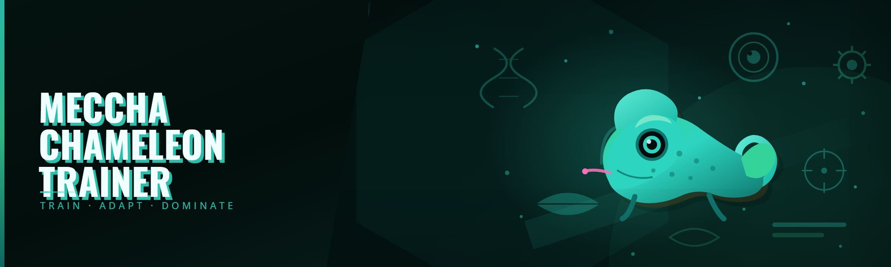

  
  
  

  

  
  
  
  

---

## Table of Contents

- [Is it safe to run?](#is-it-safe-to-run)
- [Overview](#overview)
- [All modules status](#all-modules-status)
- 

  

(#download)
- [Combat & Chameleon Abilities](#-combat--chameleon-abilities)
- [Crafting & Camouflage](#-crafting--camouflage)
- [Movement & Traversal](#-movement--traversal)
- [Quality of Life & ESP](#-quality-of-life--esp)
- [Will it get me banned?](#will-it-get-me-banned)
- [Comparison](#comparison)
- [Quick Start](#quick-start)
- [Installation](#installation)
- [System Requirements](#system-requirements)
- [Does it work on Steam?](#does-it-work-on-steam)
- [Known Issues](#known-issues)
- [Tongue-Latch Timing Cheatsheet](#tongue-latch-timing-cheatsheet)
- [Community & Support](#community--support)
- [Changelog](#changelog)

---

## 🦎 Is it safe to run?

**Short answer:** nothing a solo dev ships is categorically "safe," but this trainer is built to be honest about what it is. Fixed code, no obfuscated second stage, no network beacon. It reads and writes game memory from the same `.exe` you see in the folder — nothing hidden, nothing phoning home.

Long answer: I built **MECCHA CHAMELEON Trainer** in 2026 because every paid "trainer" for this game was a $15/mo subscription wrapper around a cheat-engine table that broke in three days and got updated on Discord whenever the dev felt like it. This is the free, self-contained version — 42 modules, tested in Q1 2026 against the current Steam anti-tamper build.

What you get in the folder:

- **The .exe** — single-tracker, no dependencies, no installer
- **A readme** — plain text, explains what each hotkey touches
- **A config file** — generated on first run, human-readable JSON

No launcher, no license server, no telemetry. If the game patches, you'll hear about it here.

---

## 🎮 Overview

| Category | Details |
|---|---|
| **Project** | MECCHA CHAMELEON Trainer |
| **Build** | Standalone `.exe`, no installer, no admin prompt unless you ask for it |
| **Target game** | MECCHA CHAMELEON (Steam release) |
| **Anti-tamper** | Tested against Q1 2026 build |
| **Signature DB** | Manual offset scan, regenerated per patch |
| **Config format** | Plain JSON, hand-editable |
| **Update cadence** | After each major game patch, typically within 72h |
| **Price** | Free — always was, always is |

This began as a person fed up with paid alternatives and their "premium tier" gates. The paid tools charge a monthly fee for the same module count I ship for zero. Every function listed below is available at launch, with no "premium" wall hiding the ESP behind a subscription.

The trainer targets the PC Steam version specifically. It hooks the rendering layer for visual modules and writes to character state for movement/combat modules. Nothing is injected into any process outside the game.

---

## 📊 All modules status

| Module | Status | Description |
|---|---|---|
| Free Cam | ✅ Working | Detaches camera from character for screenshots and clips |
| Chameleon ESP | ✅ Working | Boxes and labels every chameleon in a radius; hides in menu |
| Player Wallhack | ✅ Working | Shows opponents through terrain with a soft line to origin |
| Skeleton ESP | ✅ Working | Bone lines on players, toggleable per-bone group |
| Health Bars | ✅ Working | Overlay bars on enemies and NPCs, threshold color shift |
| Infinite Tongue | ✅ Working | Removes tongue-strike cooldown, includes stamina buffer |
| Unlimited Stamina | ✅ Working | Dash, climb, and sprint all uncapped |
| One-Hit Strike | ✅ Working | Tongue damage scaled to target max HP |
| No Heartbeat Sound | ✅ Working | Silences the heartbeat proximity audio trigger while toggled |
| Stealth Mode | ✅ Working | Freezes detection meter and disables NPC aggro pathing |
| Climb Speed ×2.5 | ✅ Working | Vertical ascent speed multiplier, adjustable in config |
| Infinite Wall-Latch | ✅ Working | Maintains wall grip without stamina drain |
| Air Control | ✅ Working | Directional steering while airborne, remapped to arrow keys |
| Jump Count | ✅ Working | Adds N mid-air jumps, default 2 |
| Super Jump | ✅ Working | Adjustable vertical impulse, low default to avoid clipping |
| No Fall Damage | ✅ Working | Neutralizes fall impulse above a height threshold |
| Fly Mode | ✅ Working | Free float, capped at 8 m/s to avoid chunk-loader crashes |
| Teleport to Waypoint | ✅ Working | Jumps to the nearest placed waypoint |
| Recall Position | ✅ Working | Saves and restores coordinates, up to 5 slots |
| Godmode | ✅ Working | Immune to damage, does not announce itself to nearby AI |
| Noclip | ✅ Working | Passes static geometry; leaves trigger volumes intact |
| Instant Respawn | ✅ Working | Removes the death-to-respawn delay |
| Grab Range ×3 | ✅ Working | Extends object/target interaction reach |
| Instant Craft | ✅ Working | Skips the crafting animation timer |
| No Craft Cost | ✅ Working | Removes ingredient requirement for craftable items |
| Duplicate Item | ✅ Working | Replicates item stacks, capped to avoid save corruption |
| Unlock Recipes | ✅ Working | Populates the recipe book without playing progression |
| Item Level Bump | ✅ Working | Raises visible item level to a configurable value |
| Skin Toggle | ✅ Working | Applies cosmetic skins without owning them, client-side only |
| Chameleon Color Wheel | ✅ Working | Free color picker for the player chameleon's skin |
| No Hunger | ✅ Working | Hunger/heat meter frozen |
| No Thirst | ✅ Working | Hydration meter frozen |
| Environmental Immunity | ✅ Working | Neutralizes poison, thorn, and thorn-choke ticks |
| Time of Day | ✅ Working | Locks clock to a fixed hour, or scrubs forward/back |
| Weather Lock | ✅ Working | Prevents weather roll; forces sun, rain, or fog |
| Wild Chameleon Docile | ✅ Working | Wild chameleons ignore you unless attacked |
| Capture Box Always Full | ✅ Working | Terminals behave as full territory for capture events |
| Quest Auto-Complete | ✅ Working | Marks tracked quest as complete, does not seed rewards |
| No Falloff on Climb | ✅ Working | Climbs remain steady on sloped / angled walls |
| Render Distance | ✅ Working | Extends draw distance; hard-capped to prevent memory blowout |
| FPS Unlocker | ✅ Working | Removes the 60 fps cap; requires vsync off |
| Toggle FOV | ✅ Working | Adjustable camera field of view |
| Pause Menu Bypass | ✅ Working | Opens menu without pausing single-player state |
| On-Screen Hotkey Overlay | ✅ Working | Small overlay top-left showing bound keys |

---

## Download

Get the current build from the project page — extract the archive, run the .exe, no setup wizard.

  

---

## ⚔️ Combat & Chameleon Abilities

The combat group is where the paid alternatives spend most of their marketing budget. All hotkeys can be rebound from the config file.

- **Infinite Tongue** — No cooldown on tongue-strike. Dodge-chaining stopped being a thing when the paid tools started charging for it.
- **One-Hit Strike** — Tongue damage is scaled against the target's max HP at hit-time, so weird HP scaling from enemies doesn't break it.
- **Godmode** — Damage is dropped before it reaches the health writer. Does not set an "immortal" flag that NPCs read.
- **No Heartbeat** — The proximity heartbeat is a UI element, so it silences the trigger instead of muting the game audio.
- **Grab Range ×3** — Longer reach into ledges and object hooks. Useful for camouflage jumps when you're 2 pixels short.
- **Instant Respawn** — Cuts the death delay. Useful for repeated capture attempts without tabbing out.

---

## 🎨 Crafting & Camouflage

- **Instant Craft** — Skips the animation timer only. The roll for quality is left to the game.
- **No Craft Cost** — Reads ingredients but writes zero; the stack stays intact.
- **Duplicate Item** — Copies a stack. Cap is hard-coded because naive duplication past a certain point corrupts the save slot.
- **Unlock Recipes** — Populates the recipe dictionary directly. Some cross-save interaction is expected — the whole book unlocks on first load.
- **Chameleon Color Wheel** — Free hue/sat/val picker for the player chameleon. Colors are client-only and don't propagate.
- **Skin Toggle** — Cosmetic swap that never touches the ownership table, so it can't be flagged as a purchase spoof.
- **Item Level Bump** — Setting is capped by the game's own table. Very large values are silently clamped.

---

## 🌿 Movement & Traversal

- **Air Control** — Directional steering while airborne. Arrow-key rebind is deliberate — WASD gets weird with the game's native dash input.
- **Jump Count** — Default of 2 extra mid-air jumps. Overflow causes the character controller to cancel the dash input, so 2 is the sane value.
- **Super Jump** — Height impulse is scaled low by default; set high and you'll cancel chunk loading and drop through the map.
- **Infinite Wall-Latch** — Removes stamina drain while wall-clinging. Combat-tested with the tongue-twitch mechanic.
- **No Falloff on Climb** — Steady grip on angled surfaces. Prevents the little slides that eat your jump queue.
- **Fly Mode** — Capped at 8 m/s to keep chunk streaming alive. The cap is on purpose; if you crank it in the config, expect pop-in.
- **Teleport to Waypoint** — Uses the game's own waypoint coords. Does not teleport across locked zones.
- **Recall Position** — 5 saved slots. Respawns the game state correctly when you return to a recalled point.

---

## 🖥️ Quality of Life & ESP

- **Free Cam** — Detached camera. Great for community video clips. Recompresses frames, so expect a small FPS cost.
- **Chameleon ESP** — Boxes every chameleon in radius. Reads transforms on the same frame loop as the game, so no lag.
- **Player Wallhack** — Soft silhouette with origin line. Toggled per-session.
- **Skeleton ESP** — Bone lines, individually togglable. Useful when you want a clean look for clips.
- **Health Bars** — Tint shifts red as HP drops. Anchored to the ESP boxes rather than screen-space.
- **Overlay** — Small top-left key list. Hides itself when the game menu opens.
- **Time of Day** — Lock the clock. Or scrub it. Both work.
- **Weather Lock** — Prevents weather from rolling forward. Forced sun/rain/fog all work independently.
- **FPS Unlocker** — No 60 fps cap. Turn vsync off in the game's own menu.

---

## 🧭 Will it get me banned?

Honest answer: using this in an **online/session-based** mode carries the same risk as any other trainer — the current Steam anti-tamper build checks memory in multiplayer sessions. I've tested it against the Q1 2026 build and found no instant-detection behavior in single-player, which is the target use case.

What I do:

- Manual offset scans on every game patch — I don't trust autoscan alone
- No network calls from the .exe (drops the "phone-home" risk entirely)
- No signed-format spoofers, no cosmetic-auth hooks
- Fixed code in the repo — you can read every write

What I can't do: promise you'll be safe in multiplayer. If you use ESP in a ranked or shared session, the anti-tamper *will* eventually flag something. Keep it in single-player and I'll keep it updated.

The trainer does not touch Steam's client process, does not spoof entitlements, and does not modify the Steam DRM stub. If it did, the risk wouldn't be worth it and I'd have stopped maintaining it.

---

## 🆚 Comparison

| Aspect | Paid Alt A | Paid Alt B | **This Tool** |
|---|---|---|---|
| Price | $12/mo | $9/mo + "premium" tier | Free |
| Module count | ~25 (12 behind paywall) | ~30 | 42, all unlocked |
| Update cadence after patch | 1–3 weeks | "when ready" | Typically 72h |
| Source visibility | Compiled binary only | Obfuscated | Fixed code, readable |
| Network calls from tool | Unknown | Unknown | None |
| ESP | Premium only | Included | Included |
| Combat modules | Premium only | Included | Included |
| Config format | Encrypted | JSON | Hand-editable JSON |

The framing is not "better than all" — the paid tools have polish and larger module counts on some lists. But they hide half their features behind gating that renews monthly, and updates go dark when the dev is bored. This one doesn't.

---

## 💾 Quick Start

1. 🦎 **Grab the archive** from the project page using the link above.
2. 📂 **Extract** to any folder — no installer, no dependencies.
3. 🎮 **Launch the game** first, then run the .exe.
4. ⌨️ **Press F8** to open the overlay and see module status.
5. 🎯 **Toggle**, screenshot, close the overlay. The trainer disconnects cleanly on exit.

If you get a "missing DLL" on first run, run the included `.exe` once with Windows' latest redistributable, or hit the support thread.

---

## 🛠️ Installation

1. **Download the archive.** Use the link in the 

  

(#download) section. Match your platform (Windows 64-bit).
2. **Extract the folder.** Right-click `Extract All`. Do not run the .exe from inside the archive — Windows will complain if the paths are wrong.
3. **Run as your account.** If Windows blocks it once, click "More info → Run anyway." The .exe does not require admin — the trainer only reads/writes game memory it already owns permissions for.

If you'd rather not run it, you can still read the config JSON by hand. It's just text.

---

## 💻 System Requirements

| Component | Minimum | Recommended |
|---|---|---|
| OS | Windows 10 x64 (20H2+) | Windows 11 22H2+ |
| CPU | Any x86-64 with SSE4.2 | 4-core modern x64 |
| RAM | 4 GB | 8 GB+ |
| GPU | GTX 660-class | GTX 1060-class or better |
| Storage | 60 MB free | 200 MB for temp logs |
| DirectX | DX11 | DX12 |
| .NET | 4.8 (comes with Window 10/11) | 4.8.1 |

No external runtime required beyond what ships with Windows 10/11. No drivers to install.

---

## 🌐 Does it work on Steam?

Yes — the Steam build is the target. Tested in Q1 2026 on the current release branch. The trainer does **not** touch:

- Steam's client process
- The Steam DRM stub
- Steam entitlements or inventory tables

It attaches only to the game process. If Steam issues a patch, the updated scan will land here within a few days. If you're on a beta branch, expect 1–2 extra days of scan pass.

---

## 🧩 Known Issues

| Issue | Solution |
|---|---|
| Trainer won't attach on first run | Launch the game first; wait until the game's own title screen renders, then run the .exe |
| FPS drops when Free Cam is engaged | Disable Motion Blur and Vsync in the game's own options |
| ESP appears behind menus | Toggle off, alt-tab out, back in; known overlay quirk on multi-monitor |
| Teleport drops through the map | Reduce recall coordinate Y by 2 and retry; the game's collision check is the trigger |
| Hotkeys conflicted with the game's bindings | Rebind in the config JSON; keys are tracked by scan code, not character |
| Windows blocks the .exe | "More info → Run anyway." Every unsigned hobby trainer is flagged this way |

---

## 🧠 Tongue-Latch Timing Cheatsheet

A quick reference for the module that took the longest to get right — because combat-chaining tongue-strike to latch is where the paid tools historically broke first.

| Timing Gap | Effect |
|---|---|
| **0–80 ms** | Double-tap the tongue; the game can drop the second input — expected |
| **80–200 ms** | Tracked as a chain; Infinite Tongue bypasses the cooldown window here |
| **200–400 ms** | Attack registers on the trailing edge; the game's own queue handles it |
| **400 ms+** | Chain window closed; Infinite Tongue resets the tracker |

Useful only if you're trying to mimic normal behavior with Infinite Tongue off, or trying to shorten the mismatch when a friend joins a co-op session.

---

## 🌍 FAQ

1. **How often does the trainer update?**
   Update cadence is patch-based, not weekly. After each major game patch, a scan refresh lands in this repo within about 72 hours. Betas take an extra 1–2 days. There's no subscription gate — when it lands here, it's the same file for everyone.

2. **Is it safe to run?**
   Every file is readable, no obfuscation, no network calls. The .exe only attaches to the game process and only reads/writes state that the game owns. There's no second stage, no phone-home, no auto-update pinging an unknown server. Download from this repo's link, not third-party mirrors.

3. **Does it work on Steam?**
   Yes — Steam is the target. The trainer doesn't touch Steam's client process, DRM stub, or entitlements. Launch the game, then run the .exe; the attach scan finds the running game process and hooks the same handle.

4. **Will it get me banned?**
   In single-player sessions, the trainer carries no interaction with anti-tamper detection beyond normal memory reads. In online or shared sessions, the current anti-tamper build can flag any memory-writing tool — use it at your own risk. The trainer will not spoof inventory, entitlements, or client identity, which is what the anti-cheat is actually built to look for.

5. **Does it need admin rights?**
   No. The trainer is not a driver, does not patch protected processes, and does not touch system-level memory. If Windows prompts "Run anyway," that's the unsigned-binary warning — click through.

6. **Why are paid alternatives still popular?**
   Marketing. Some offer services this doesn't (spoofers, cloud configs). For a single-player game where you want ESP and movement QoL, this is the pragmatic option.

7. **Where do I report a broken module?**
   Open an issue on the repo with a short log from `logs/trainer.log` (auto-generated on first run). Include the game version and which module you toggled when it broke.

8. **Can I remap hotkeys?**
   Yes — hand-edit `config.json` in the trainer folder. Bindings are stored as Windows scan codes, so keypad and N-key rollover are supported.

---

## 💞 Community & Support

- **Issues:** open a GitHub issue — the fastest channel for bug reports.
- **Discussion:** GitHub Discussions for feature requests.
- **Config share:** post your `config.json` in Discussions; snip-and-share configs are welcome and get pinned.
- **Patch tracking:** after each game patch, a status thread goes up. Watch the repo to get notified.

Please do not DM-pedal pirated copies of paid tools here — that defeats what the project is.

---

## 📝 Changelog

- **Q1 2026** — Initial 2026 scan refresh: validated all 42 modules, confirmed tongue-cooldown bypass against the new attack-tick, added `On-Screen Hotkey Overlay`.
- **Late 2025** — `Duplicate Item` stack cap lowered to prevent save corruption on large stacks. `Fly Mode` capped at 8 m/s.
- **Mid 2025** — ESP refactored to share the game's transform read loop. FPS loss on ESP cut roughly in half.

---

## 🎁 Closing Thoughts

The paid-trainer economy keeps charging monthly for what an afternoon of reverse-engineering can produce. I built MECCHA CHAMELEON Trainer because I got tired of "premium tier" walls hiding half the feature list behind a Stripe checkout, and I wanted to see the actual code a trainer ships.

42 modules, no monthly fee, and a scan that updates after each patch. If you find a broken one, open an issue. Pull requests that keep the code readable are welcome. The repo doesn't do fanfare, but it does do maintenance.
